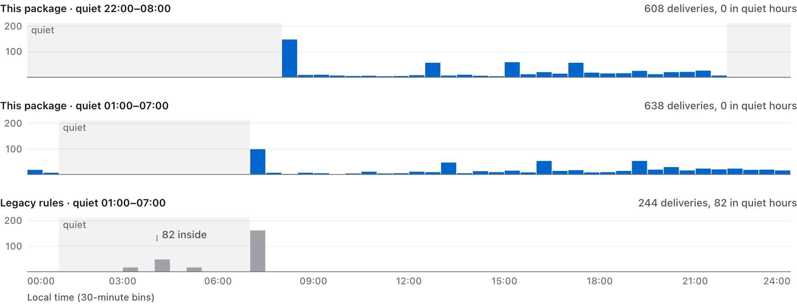

# nudge-scheduler

A Swift package that decides which friends to remind you to contact, and when to send each reminder so it never lands in your quiet hours. It is fully deterministic: the engine never reads the clock or the system calendar, so every result can be tested and replayed exactly.



## Highlights

- **Zero quiet-hour violations in 638 deliveries** over a simulated year with quiet hours 01:00 to 07:00, against 82 of 244 for the legacy behavior it replaces.
- **Max wait at the default cap of 3 is 2 / 3 / 4 days** for inner, close and outer contacts, down from 48 / 80 / 54 days under the legacy rules.
- **Exhaustive DST property tests**: all 576 quiet-hour start/end pairs, checked at instants around both 2026 daylight-saving changes in America/Los_Angeles.
- **Reproducible**: a seeded simulation sweeps the daily cap over 200 synthetic years, and the same seed produces byte-identical output.

## Quickstart

Requires Swift 6 (Xcode 16 or later). No dependencies.

```sh
swift build
swift test
swift run -c release nudge-sim --seed 42 --out site   # about 55 s on an M-series Mac
open site/index.html
```

## Usage

Give it contacts (opaque IDs) with rings, last-contact dates and birthdays, plus quiet hours, a daily cap and snoozes. The engine returns a ranked list, the planner returns delivery times, and every call takes `now` and a `Calendar` explicitly.

```swift
import NudgeScheduler

let settings = try NudgeSettings(dailyCap: 3, quietHours: try QuietHours(startHour: 22, endHour: 8))
let engine = NudgeEngine(settings: settings)

var snoozes = SnoozeBook()
snoozes.snooze(ContactID("a1"), now: now, calendar: calendar)   // 7 days by default

let nudges = engine.nudges(for: contacts, now: now, calendar: calendar, snoozes: snoozes)
let times = DeliveryPlanner.dates(count: nudges.count, now: now, quietHours: settings.quietHours, calendar: calendar)
```

## Rules

| Rule | Behavior |
|---|---|
| Rings | inner 10 days, close 20, outer 40, distant never drifts. `Contact.cadenceDays` overrides. |
| Drift priority | 50 + min(days overdue, 40), so it peaks at 90 |
| Birthday priority | 100 on the day, 95 the day before, 80 a week before |
| Leap-day birthdays | Feb 29 is observed on Feb 28 in common years |
| One slot per contact | If a contact has a birthday and a drift nudge on one day, only the higher priority one is kept |
| Order | priority, then kind (birthday, drift, check-in), then ring, then contact ID. Input order never matters. |
| Daily cap | `NudgeSettings.dailyCap`, 1 to 10, the only cap. Out-of-range values throw. |
| Quiet hours | Any start and end hour. 22:00 to 08:00 wraps midnight, 01:00 to 07:00 does not, equal start and end means none. Windows that leave less than an hour a day throw. |
| Delivery | At least 15 minutes after `now`, spread evenly over the rest of the current allowed window, or over the next window if fewer than 15 minutes per nudge remain |
| Snoozes | Keyed by `ContactID` with an expiry. Expired entries are ignored and `prune(now:)` removes them. |

## Testing

`swift test` runs 26 tests in 4 suites. Each rule above has a regression test named after the bug it prevents.

Property tests use a seeded SplitMix64 generator, so any failure reproduces exactly:

- All 576 quiet-hour start/end pairs, counts 1 to 10, and 12 instants per case sampled from 3-day windows around both 2026 DST changes: no delivery inside quiet hours, none before `now`, strictly increasing.
- Every 15-minute instant in those windows for three quiet-hour settings, with 10 nudges.
- 200 generated contact sets per cap from 1 to 10: never more than the cap, never a repeated contact, priorities non-increasing.
- 100 seeded shuffles of one input give identical output.
- A full simulated year at caps 1, 3 and 10 has 0 quiet-hour violations, and the same seed produces byte-identical JSON.

## Simulation

`nudge-sim` simulates every day of 2026 in America/Los_Angeles for 40 invented contacts (5 inner, 10 close, 15 outer, 10 distant). Each day the user opens the app at a random minute, replies to a nudge with probability 0.6 and snoozes 25% of the rest. Contact also happens without a nudge at a fixed daily rate per ring. These rates are modelling assumptions, not measurements. "Wait" is the number of days from the first overdue day to the first nudge.

The report compares the engine with a re-implementation of the behavior it replaces ([`LegacyBaseline.swift`](Sources/NudgeScheduler/LegacyBaseline.swift)): a hard cap of 3, a drift priority that stops at 80, no per-contact dedupe, snoozes that never expire, and a planner that assumes quiet hours wrap midnight.

Results for seed 42 (from [`site/results.json`](site/results.json)):

| | This package | Legacy |
|---|---|---|
| Deliveries inside quiet hours, quiet 01:00 to 07:00, cap 3 | 0 of 638 | 82 of 244 |
| Max wait at cap 3, inner / close / outer (days) | 2 / 3 / 4 | 48 / 80 / 54 |
| Overdue episodes never nudged by year end | 0 | 9 |
| Slots spent on a second nudge for one contact | 0 | 1 |

Because legacy snoozes never expire, every snoozed contact drops out for the rest of the year. That is why the legacy run delivers 0.65 nudges a day against 1.67 for this package.

Cap sweep, pooled over seeds 42 to 61 (20 simulated years per cap). Each cell is the p90 wait in days, then the max:

| Cap | Inner | Close | Outer | Outer episodes never nudged | Nudges per day |
|---|---|---|---|---|---|
| 1 | 17, 30 | 18, 39 | 20, 37 | 57 of 1722 | 1.00 |
| 2 | 3, 9 | 3, 10 | 4, 12 | 9 of 1922 | 1.61 |
| 3 | 1, 6 | 1, 5 | 1, 5 | 2 of 1936 | 1.70 |
| 4 | 0, 4 | 0, 6 | 1, 5 | 0 of 2005 | 1.71 |

From cap 3 up the cap rarely binds (about 1.7 nudges a day), so raising it further changes little for this group.

## Limitations

- The simulation models one user and one synthetic group with assumed reply, snooze and contact rates. Use the cap sweep to compare settings, not as a forecast.
- The legacy baseline was re-implemented from a description of the old behavior, not from the original code.
- Delivery times have minute precision, and the planner does not account for notifications the host app has already scheduled.
- The full sweep (200 simulated years) takes about 55 seconds, mostly in `Calendar` arithmetic.

## License

MIT, see [LICENSE](LICENSE).
